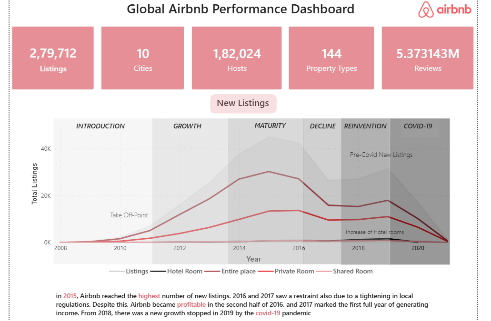
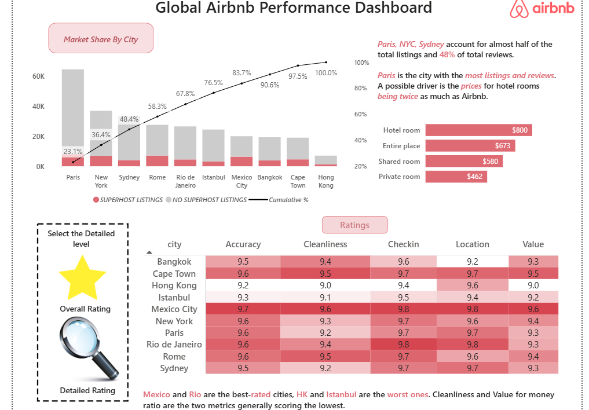
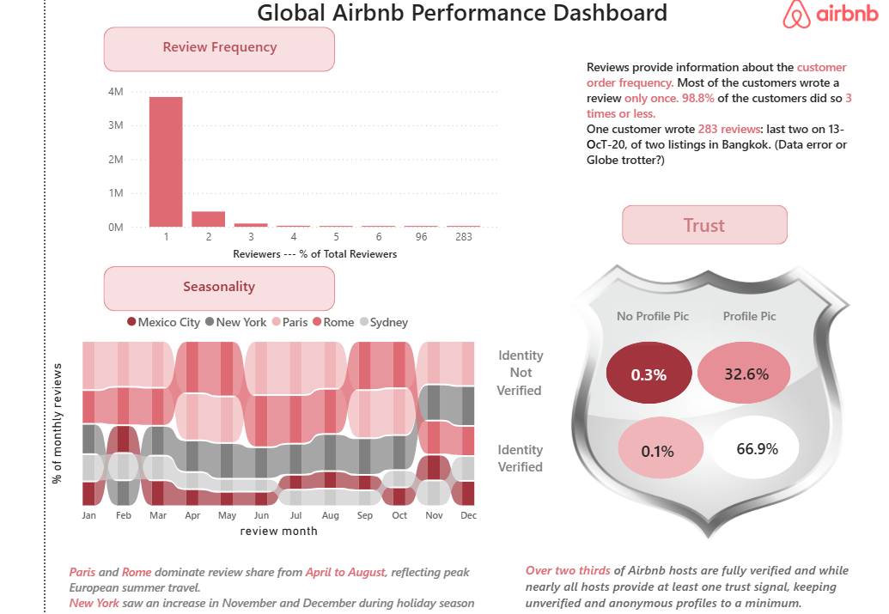

# 🏠 Global Airbnb Performance Dashboard

An interactive, multi-page business intelligence dashboard analysing **Airbnb listings, hosts and reviews across 10 major global cities**. The report tells the story of Airbnb's growth, how guests review and travel through the year, which cities dominate the market, how listings are rated, and how much trust signals (verification and profile pictures) matter on the platform.

> **Tool:** Power BI &nbsp;|&nbsp; **Domain:** Travel & Hospitality / Sharing Economy &nbsp;|&nbsp; **Type:** Descriptive & exploratory analytics

---

## 📑 Table of Contents

1. [Project Overview](#-project-overview)
2. [Business Objectives](#-business-objectives)
3. [Dataset at a Glance](#-dataset-at-a-glance)
4. [Dashboard Pages & Visuals](#-dashboard-pages--visuals)
5. [Key Insights](#-key-insights)
6. [Data Quality Observations](#-data-quality-observations)
7. [Tools & Techniques](#-tools--techniques)
8. [Repository Structure](#-repository-structure)
9. [How to Use](#-how-to-use)
10. [Future Improvements](#-future-improvements)
11. [Author](#-author)

---

## 📌 Project Overview

Airbnb has transformed the global accommodation industry. This project consolidates listing, host and review data from **10 cities across 6 continents** into a single, easy-to-navigate dashboard that answers questions such as:

- How did Airbnb grow, mature, decline and reinvent itself over time?
- Which cities hold the largest share of the market?
- How do guests behave when leaving reviews, and when do they travel?
- Which cities and rating categories perform best and worst?
- How much of the host base is verified and trustworthy?

The dashboard is designed with a consistent Airbnb-inspired coral/red colour palette, short written takeaways beside every visual, and interactive elements for deeper exploration.

---

## 🎯 Business Objectives

| # | Objective |
|---|-----------|
| 1 | Understand the **lifecycle** of Airbnb listings from 2008 to the COVID-19 period |
| 2 | Measure **market concentration** across cities (Pareto / 80-20 view) |
| 3 | Compare **pricing** across room types |
| 4 | Evaluate **guest satisfaction** across cities and rating dimensions |
| 5 | Analyse **review behaviour** and **seasonality** of demand |
| 6 | Assess **trust & safety** through host identity verification and profile pictures |

---

## 📊 Dataset at a Glance

| Metric | Value |
|--------|-------|
| Total Listings | **279,712** |
| Cities Covered | **10** |
| Unique Hosts | **182,024** |
| Property Types | **144** |
| Total Reviews | **~5.37 million** |

**Cities included:** Bangkok, Cape Town, Hong Kong, Istanbul, Mexico City, New York, Paris, Rio de Janeiro, Rome, Sydney.

**Room types:** Entire place, Private room, Shared room, Hotel room.

---

## 🖥️ Dashboard Pages & Visuals

The report consists of **three pages**.

### Page 1 — Overview & Growth Story (KPIs + New Listings Timeline)

- **KPI Cards:** Listings, Cities, Hosts, Property Types and Reviews at a glance.
- **New Listings Over Time (area/line chart):** Total new listings per year from 2008 to 2021, broken down by room type (Hotel Room, Entire Place, Private Room, Shared Room), with the background shaded by **business lifecycle phases**:
  - **Introduction** → **Growth** → **Maturity** → **Decline** → **Reinvention** → **COVID-19**
  - Annotations highlight the *Take-Off Point*, *Pre-COVID New Listings* and the *Increase of Hotel Rooms*.

  


### Page 2 — Market Share, Pricing & Ratings

- **Market Share by City (Pareto chart):** Stacked columns of listings per city split by **Superhost vs. non-Superhost**, with a **cumulative % line** to show market concentration.
- **Average Price by Room Type (bar chart):** Hotel room, Entire place, Shared room and Private room.
- **Ratings Heatmap (matrix):** Accuracy, Cleanliness, Check-in, Location and Value for each city, colour-scaled so strong and weak areas stand out instantly.
- **Interactive selector:** A "Select the Detailed level" button panel (⭐ *Overall Rating* / 🔍 *Detailed Rating*) lets users toggle between a summary and a granular view.
- 


### Page 3 — Reviews, Seasonality & Trust

- **Review Frequency (column chart):** Distribution of how many reviews each reviewer has written.
- **Seasonality (ribbon chart):** Share of monthly reviews per city (Mexico City, New York, Paris, Rome, Sydney) across January–December, showing how rankings change through the year.
- **Trust Shield (2×2 matrix):** Hosts segmented by *Identity Verified* vs. *Not Verified* and *Profile Picture* vs. *No Profile Picture*.
- 

---

## 💡 Key Insights

### 📈 Growth & Lifecycle
- **2015** was the peak year for new listings (roughly 45K new listings in a single year), driven mainly by **Entire place** listings.
- **2016 and 2017** saw a slowdown, partly due to the **tightening of local regulations** in several cities.
- Airbnb turned **profitable in the second half of 2016**, and **2017** was its first full year generating income.
- From **2018**, a new phase of growth began, including a rise in **hotel rooms** on the platform, before it was halted in **2019/2020 by the COVID-19 pandemic**.

### 🌍 Market Concentration
- **Paris, New York and Sydney** together account for almost half of all listings (**48.4% cumulative**) and about **48% of total reviews**.
- **Paris** is the largest market, with the most listings and reviews (23.1% of listings). A possible driver is that hotel prices in Paris are roughly **twice** the cost of an Airbnb.
- Cumulative share by city: Paris 23.1% → New York 36.4% → Sydney 48.4% → Rome 58.3% → Rio de Janeiro 67.8% → Istanbul 76.5% → Mexico City 83.7% → Bangkok 90.6% → Cape Town 97.5% → Hong Kong 100%.

### 💰 Pricing
| Room Type | Average Price |
|-----------|---------------|
| Hotel room | $800 |
| Entire place | $673 |
| Shared room | $580 |
| Private room | $462 |

### ⭐ Ratings by City
| City | Accuracy | Cleanliness | Check-in | Location | Value |
|------|:--------:|:-----------:|:--------:|:--------:|:-----:|
| Bangkok | 9.5 | 9.4 | 9.6 | 9.2 | 9.3 |
| Cape Town | 9.6 | 9.5 | 9.7 | 9.7 | 9.5 |
| Hong Kong | 9.2 | 9.0 | 9.4 | 9.6 | 9.0 |
| Istanbul | 9.3 | 9.1 | 9.5 | 9.4 | 9.2 |
| Mexico City | 9.7 | 9.6 | 9.8 | 9.8 | 9.6 |
| New York | 9.6 | 9.3 | 9.7 | 9.6 | 9.4 |
| Paris | 9.6 | 9.2 | 9.7 | 9.7 | 9.3 |
| Rio de Janeiro | 9.6 | 9.4 | 9.8 | 9.8 | 9.3 |
| Rome | 9.6 | 9.5 | 9.7 | 9.6 | 9.4 |
| Sydney | 9.5 | 9.2 | 9.7 | 9.7 | 9.3 |

- **Mexico City** and **Rio de Janeiro** are the best-rated cities; **Hong Kong** and **Istanbul** are the weakest.
- **Cleanliness** and **Value for money** are generally the two lowest-scoring metrics across all cities, making them the biggest opportunity areas for hosts.

### 📝 Review Behaviour
- Most customers wrote a review **only once**; **98.8%** of reviewers left **3 reviews or fewer**.
- Review frequency is heavily right-skewed, with a very long tail of rare "power reviewers".

### 📅 Seasonality
- **Paris and Rome** dominate the share of reviews from **April to August**, reflecting peak European summer travel.
- **New York** sees an increase in **November and December**, coinciding with the holiday season.

### 🛡️ Trust & Safety
| | No Profile Pic | Profile Pic |
|---|:---:|:---:|
| **Identity Not Verified** | 0.3% | 32.6% |
| **Identity Verified** | 0.1% | **66.9%** |

- **Over two-thirds (66.9%)** of Airbnb hosts are fully verified (identity verified + profile picture).
- Nearly all hosts provide **at least one trust signal**, keeping unverified and anonymous profiles to a minimum (only 0.3% have neither).

---

## 🧹 Data Quality Observations

- One reviewer appears to have written **283 reviews**, with the last two posted on **13 October 2020** for two listings in **Bangkok**. This could be either a **data error** or a genuine "globetrotter" and was flagged rather than removed.
- Review counts per reviewer were grouped to keep the chart readable despite extreme outliers (e.g., 96 and 283 reviews).

---

## 🛠️ Tools & Techniques

- **Power BI Desktop** — data modelling, DAX measures, report design
- **Power Query** — data cleaning and transformation
- **DAX** — KPI measures, cumulative %, Pareto calculations, percentage-of-total logic
- **Visual types used:** KPI cards, area/line chart, Pareto (column + line), bar chart, matrix heatmap with conditional formatting, ribbon chart, column chart, custom shape/button navigation, bookmarks
- **Design:** Custom Airbnb-inspired colour palette, annotated storytelling, written takeaways next to each visual

---

## 📁 Repository Structure

```
├── README.md
├── Airbnb_Dashboard.pbix        # Power BI report file
├── data/                        # Source / cleaned datasets
├── images/                      # Dashboard screenshots
│   ├── page1_overview.png
│   ├── page2_market_ratings.png
│   └── page3_reviews_trust.png
└── docs/                        # Additional documentation (optional)
```

> Update file names and folders to match your actual repository.

---

## 🚀 How to Use

1. **Clone** the repository:
   ```bash
   git clone https://github.com/<your-username>/<your-repo-name>.git
   ```
2. Install **Power BI Desktop** (free) from Microsoft.
3. Open `Airbnb_Dashboard.pbix`.
4. If prompted, update the data source path to the `data/` folder and click **Refresh**.
5. Use the slicers, buttons and cross-filtering to explore the dashboard.

---

## 🔮 Future Improvements

- Add **price vs. rating** analysis per city and neighbourhood
- Include **occupancy / availability** metrics and revenue estimates
- Build a **Superhost impact** analysis (ratings and pricing vs. non-Superhosts)
- Add **geospatial maps** of listing density
- Normalise prices to a **single currency** and adjust for inflation
- Add **forecasting** for post-COVID recovery of new listings

---

## 👤 Author

**Your Name**
- 🔗 LinkedIn: [your-linkedin-url](https://www.linkedin.com/in/sambita-dutta8/)
- 📧 Email: sambitadutta8@gmail.com

---

⭐ If you found this project useful, please consider giving the repository a star!

*Disclaimer: This project is for educational and portfolio purposes only and is not affiliated with or endorsed by Airbnb, Inc.*
